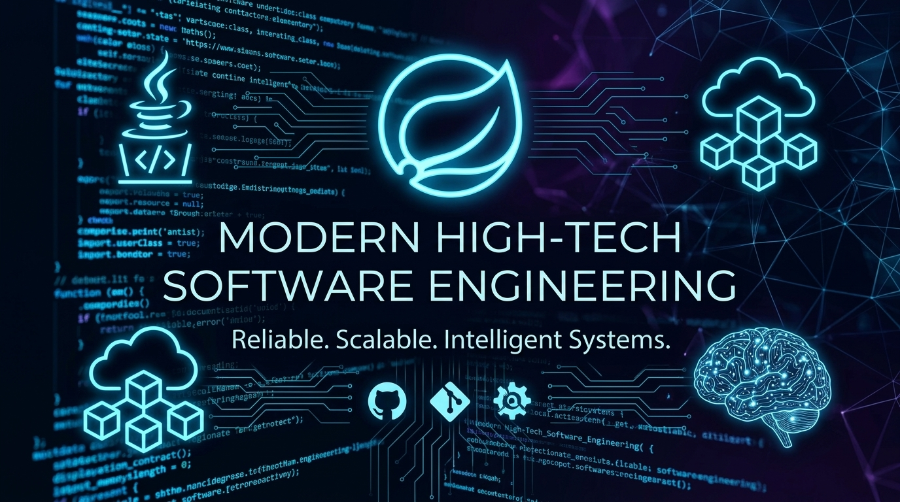

# 📊 Dossiê Técnico Executivo & Ecossistema de Certificações

---

## 📌 Visão Geral do Projeto

Este repositório armazena o código-fonte do **Dashboard Analítico Executivo e Dossiê de Certificações**, desenvolvido para consolidar e expor de forma interativa, auditável e em tempo real as credenciais técnicas, formações e projetos de engenharia e inteligência artificial de **Rafael Ornelas Tozato**.

---

## 🚀 Ecossistema e Canais Oficiais

* **🌐 Dashboard Online (Vercel):** https://tozato-dossie-executivo.vercel.app
* **📱 Aplicativo Principal (Dev Hub):** https://tozato-dev-hub.vercel.app
* **💼 Perfil Profissional (LinkedIn):** https://www.linkedin.com/in/rafaeltozato81
* **💻 Repositórios (GitHub):** https://github.com/Rafael-TOZATO
* **✍️ Artigos & Publicações (Medium):** https://medium.com/@ornelas.tozato
* **🏅 Perfil DIO & Credenciais:** https://web.dio.me/users/ornelas_tozato

---

## 🛠️ Stack Tecnológica & Arquitetura

* **Interface / Frontend:** React.js, Tailwind CSS, Componentes Glassmorphism Customizados.
* **Hospedagem & Deploy Contínuo:** Vercel (Edge Network).
* **Controle de Versão:** Git & GitHub com automação por Webhooks e Tokens Fine-Grained.
* **Design System:** Dark Mode corporativo (Fundo #0b1329, destaques em Azul Ciano e Verde Neon).

---

## 📊 Matriz de Certificações Oficiais

| Categoria / Domínio | Trilha / Instituição | Status |
| :--- | :--- | :--- |
| **Inteligência Artificial & Agentes** | Microsoft: Foundry Agentic Engineer | ✅ Concluído |
| **IA Empresarial & RAG** | Bootcamp IBM Bob (IA Empresarial) & Santander/DIO (RAG com ChromaDB, LlamaIndex e Python) | ✅ Concluído |
| **Engenharia de Dados & Streams** | Confluent Cloud: Pipeline Real-Time End-to-End (Kafka, Flink SQL, Debezium) | ✅ Concluído |
| **Inovação & Fundamentos** | Universia / DIO: Fundamentos de IA Generativa | ✅ Concluído |
| **Engenharia de Software** | Lab Padrões de Projeto com Java (GoF) e Spring Framework (DIO) | ✅ Concluído |
| **Governança & Processos** | Escola EDTI: Green Belt / White Belt em Lean Six Sigma | ✅ Concluído |
| **Data Analytics & BI** | Formação Power BI, MySQL, Azure & Dashboards Corporativos | ✅ Concluído |

---

## 📬 Contatos

- 💼 **LinkedIn:** [rafaeltozato81](https://www.linkedin.com/in/rafaeltozato81)
- 🐙 **GitHub:** [Rafael-TOZATO](https://github.com/Rafael-TOZATO)
- ✍️ **Medium:** [@ornelas.tozato](https://medium.com/@ornelas.tozato)
- 🌐 **Portfólio PWA (Dev Hub):** [tozato-dev-hub.vercel.app](https://tozato-dev-hub.vercel.app)
- 🌐 **H-Folio:** [h-folio-psi.vercel.app](https://h-folio-psi.vercel.app)
- 🚀 **Aurora BI (Lovable):** [aurora-bi-dio.lovable.app](https://aurora-bi-dio.lovable.app)
- 📜 **Microsoft Learn:** [Transcript](https://learn.microsoft.com/pt-br/users/rafaelornelastozato-2209/transcript/dzo2wizrzkx2853)

---

*Desenvolvido com rigor técnico e foco em Governança 4.0.*  
**Rafael Ornelas Tozato**

